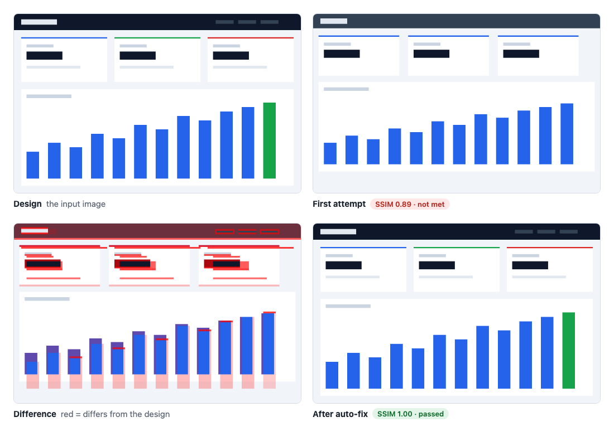
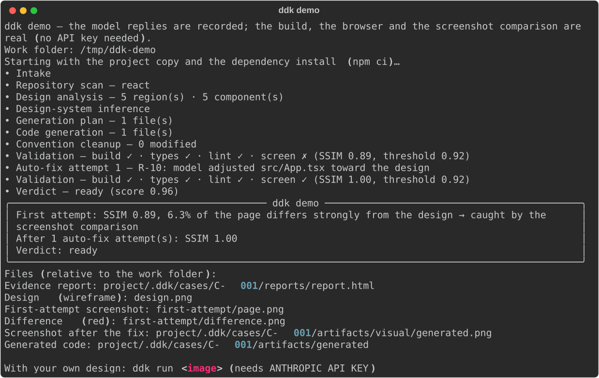
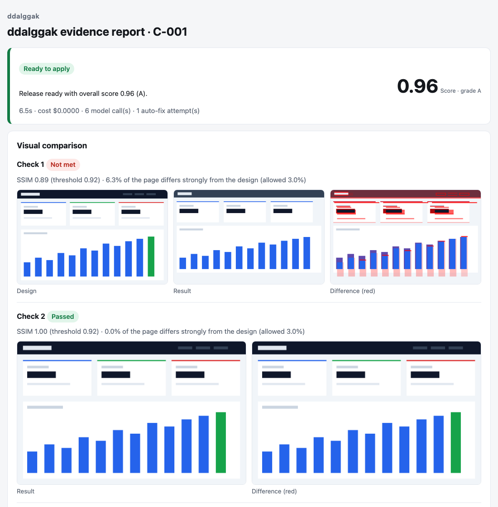

# 딸깍 (ddalggak)

**디자인 이미지를 넣으면, 검증된 코드가 나옵니다.**

[](https://github.com/dogskip/ddal-ggak/actions/workflows/ci.yml)
[](LICENSE)
[](pyproject.toml)

[English](README.md) · 한국어

`ddk` 는 디자인 이미지로 내 저장소에 넣을 코드를 생성하고, 그 결과를 스스로 검증합니다. 프로젝트를
빌드하고, 타입 검사와 린트를 실행하고, 실제 헤드리스 브라우저에서 화면을 열어 디자인과 비교합니다.
어긋난 곳을 고친 뒤에야 "적용해도 되는지"를 알려 줍니다. `ddk apply` 를 실행하기 전에는 저장소에
생성 소스를 반영하지 않습니다.

<picture>
  <source media="(max-width: 600px)" srcset="docs/assets/before-after-mobile.png">
  
</picture>

이 그림은 보관된 응답과 단순 도형 화면을 사용하는 예제입니다. 기준·첫 결과·수정 결과를
순서대로 표시합니다. 빨간 차이 표시는 아래 검증 보고서에서 확인할 수 있습니다.

## 1분 체험 (API 키 불필요)

```bash
uvx --from git+https://github.com/dogskip/ddal-ggak ddk demo
```

[uv](https://docs.astral.sh/uv/), npm 이 들어 있는 Node.js (20.19 이상 또는 22.12 이상), 그리고 Chrome·Edge·
Chromium 중 하나가 필요합니다. 브라우저가 없으면 `ddk demo` 가 헤드리스 Chromium(약 100MB, 한 번만)을
내려받을지 묻습니다.



데모는 미리 녹화한 모델 응답을 재생하므로 키가 필요 없습니다. 그 밖의 모든 단계는 실제로 실행됩니다.
`npm ci`, 빌드, 타입 검사, 린트, 미리보기 서버, 헤드리스 Chromium, 화면 비교가 그렇습니다. 첫 시안은
디자인과 어긋나고(SSIM 0.89), 그것을 잡아낸 뒤 수정을 적용하면 두 번째 시도가 통과합니다(SSIM 1.00).

## 현재 저장소의 변경 검증

`ddk up "제목 변경과 기존 이동 보존" --dry-run --json`으로 계획을 확인합니다.
`ddk init --discover --json`으로 미승인 초안을 생성합니다. 독립적인 목표·보존 검사를 검토하고
`ddk init --approve-draft --json`으로 승인하면 `ddk up ... --trusted-local`이 Git 변경과 실제 환경을
고정하고 화면을 표시하지 않는 Chromium에서 검사한 뒤 검토 자료를 생성합니다.
`--repair --confirm-provider`는 예산 내 수정, `--apply`와 저장·작업 중지 확인은 관리된 반영을 요청합니다.
인수 기준이 없으면 실행 전에 중단합니다.

[한 번의 명령 사용 안내](docs/ONECLICK.ko.md)는 `init`, `doctor`, `up`, `probe`, 시험 보고,
Policy, 재생성 가능한 SQLite·FTS5, 제한된 증거 조회, 현재 소스 검사, 오프라인 재검사와
검증용 MCP 도구 열한 개를 설명합니다.
아래 이미지 기반 명령은 기존 계약으로 계속 제공합니다. 이전 `ddk init PATH`는 `ddk workspace-init PATH`입니다.

## 내 디자인으로 실행

```bash
uv tool install git+https://github.com/dogskip/ddal-ggak     # pipx, pip 도 가능
export ANTHROPIC_API_KEY=sk-ant-...

cd my-vite-app                       # package.json 이 있는 저장소. 먼저 npm install
ddk run design.png                   # -p "다크 테마, 기존 Button 재사용" 으로 방향 지정
ddk report --open                    # 증거 보고서 (HTML 한 장)
ddk apply --dry-run                  # 바뀔 파일 미리 확인
ddk apply                            # 파일 적용. 교체되는 파일은 먼저 보관
```

`node_modules` 가 없으면 검사를 실행할 수 없습니다. 먼저 설치하거나 `--install` 을 붙이세요(임시 복사본에서
생명주기 스크립트를 실행하지 않고 설치합니다). `ddk run` 의 종료 코드는 판정이 `ready` 이면 0, 다른 판정이거나
시작하지 못했으면 1, 설정이 잘못됐으면 2 입니다.



## 동작 방식

1. **읽기.** 저장소(프레임워크, 규칙, 스타일)를 훑고, Claude 의 이미지 이해로 디자인을 분석합니다.
   영역, 구성요소, 토큰을 추출합니다.
2. **생성.** 만들 파일을 계획하고, 기존 코드의 스타일에 맞춰 작성합니다.
3. **검사.** 저장소를 임시 폴더에 복사하고 프로젝트가 정의한 것을 실행합니다. 빌드, 타입 검사, 린트가
   그렇습니다. 프로젝트에 없는 단계는 이유와 함께 "건너뜀"으로 기록합니다.
4. **비교.** 빌드한 앱을 루프백 주소에서 실행하고, 디자인과 같은 크기의 헤드리스 Chromium 에서 스크린샷을
   찍어 디자인과 비교합니다(SSIM, 그리고 크게 다른 면적의 비율).
5. **수정.** 실패를 분류합니다. 먼저 결정적인 수정 두 종류(사용하지 않는 import, 잘못된 상대 경로 import)를
   적용합니다. 그다음 모델이 파일 하나씩 진단 결과로 고치고, 고칠 코드 진단이 하나도 남지 않았을 때에만
   화면 어긋남을 디자인, 스크린샷, 빨간색 차이 이미지를 보고 고칩니다. 모델에게는 의존성 추가와
   `package.json`·`tsconfig`·린트 설정 변경을 금지하며, 답이 비었거나 잘렸거나 검사를 조용하게 만들면
   (`any`, `@ts-ignore`, `eslint-disable`) 버립니다. 반복은 `DDK_MAX_RETRY_ATTEMPTS`(기본 3)에서
   멈추거나 같은 실패가 되돌아오면 멈춥니다.
6. **판정.** 판정은 모델의 자기 주장이 아니라 디스크에 있는 증거로 계산합니다.

| 판정 | 조건 |
| --- | --- |
| `ready` | 차단 사유가 없고 점수가 0.85 이상 |
| `manual-review` | 자동 수정이 포기했거나(반복 소진, 같은 실패 재발) 점수가 0.85 미만 |
| `blocked` | 검사가 실패했거나, 화면을 비교하지 못했거나, 검증된 것이 없거나, 환경이 검사를 실행하지 못함 |

각 case 의 파일은 `.ddk/cases/C-NNN/` 에 모입니다. 판정, 점수표, 증거 묶음, 자동 수정 기록, 모델 호출별
비용, 비교 회차마다의 스크린샷이 들어 있습니다.

## 화면 비교의 기준과 한계

**SSIM 0.92 이상**이고 **디자인과 크게 다른 면적이 3% 이하**이면 통과합니다. 두 기준은 모두 설정입니다
(`--ssim-threshold`, `--max-mismatch`, 또는 `DDK_SSIM_THRESHOLD`, `DDK_MAX_MISMATCH_RATIO`).
`--no-visual` 은 비교를 면제하며, 면제했다는 사실이 보고서에 기록됩니다. 지원하는 미리보기 서버나
브라우저가 없으면, 이미지로 시작한 실행은 믿고 통과시키지 않고 `blocked` 가 됩니다.

초록 불을 믿기 전에 한계를 알아 두세요.

- 여기서 SSIM 은 회색조 블록으로 계산하므로, 밝기가 같고 색만 다른 변화는 통과할 수 있습니다.
- 거의 빈 화면이거나 매우 단조로운 디자인은 맞추기 쉬워서, 이 검사로는 알 수 있는 것이 적습니다.
- 첫 번째 디자인 이미지만, 그 이미지의 크기로 비교합니다.
- 불러올 때마다 달라지는 것(애니메이션, 무작위·실시간 데이터)은 올바른 화면도 실패시킬 수 있습니다.
- 브라우저는 루프백 주소로만 접속할 수 있어서, 원격 글꼴과 이미지는 불러오지 않습니다.
- 유사도는 대리 지표이지 디자인 검수가 아닙니다. 적용하기 전에 보고서를 읽으세요.

## 안전 모델

- 생성한 파일은 저장소의 임시 복사본에 놓입니다. 내 파일을 바꾸는 단계는 `ddk apply` 뿐입니다. 실행은
  `.ddk/` 폴더(스스로 git 에서 제외됩니다)를 추가하고, git 저장소라면 수정 회차마다 ref
  `refs/ddk/fix/<case>/attempt-N` 하나를 만들 뿐입니다. 실행한 뒤 직접 고친 파일은 충돌로 알리며,
  해결하기 전에는 아무것도 기록하지 않습니다.
- 복사본에는 `.git`, `.env`, 키·자격 증명 파일이 들어가지 않으며, 이 파일들은 프롬프트에도 포함하지
  않습니다. 빌드 명령은 허용 목록의 환경 변수만 받고 `HOME` 은 복사본 안을 가리키므로, API 키와 홈
  폴더가 넘어가지 않습니다.
- 의존성은 `--ignore-scripts` 로 설치합니다. 실행할 수 있는 명령은 허용 목록(`npm`, `pnpm`, `yarn`,
  `bun`, `npx`, `node`, `tsc`, `vite`, `git`)으로 제한됩니다.
- 임시 복사본은 운영체제 수준의 샌드박스가 아닙니다. 프로젝트 자신의 빌드 스크립트는 내 컴퓨터에서
  그대로 실행됩니다. 생성된 코드는 모르는 사람이 보낸 변경 요청(PR)처럼 취급하고, 변경 내용을 검토하세요.
- `DDK_COST_CAP_USD`(기본 2.0)를 넘으면 새 모델 호출을 시작하지 않습니다. 진행 중이던 호출은 한도를
  넘겨서 끝날 수 있습니다.

## 명령

| 명령 | 설명 |
| --- | --- |
| `ddk demo` | 내장 페이지로 전체 절차 체험 (API 키 불필요) |
| `ddk run <이미지>…` | 생성, 검사, 비교, 수정, 판정 |
| `ddk report` | case 의 증거 보고서 생성 (`--open` 으로 바로 열기) |
| `ddk apply` | 기존 이미지 실행의 `ready` 결과 반영. `--dry-run`으로 계획 조회, 충돌 시 중단 |
| `ddk status`, `ddk certify` | 저장된 case 상태와 판정 조회 |
| `ddk init`, `ddk up`, `ddk probe` | 해시 없는 준비, Git 변경 검사·수정, 실제 화면 자료 수집 |
| `ddk change init/reindex/verify/repair/status/export/apply/recover` | 고정 기준으로 기존 변경 검사, 증거 조회·내보내기·반영·복구 |
| `ddk doctor` | Python·Git·Docker·Chromium·글꼴·제공자 점검. `--json` 구조화 출력, `--dry-run` 설치 제외 |
| `ddk design new "<아이디어>"` | Design Studio: 아이디어를 설계 문서로 변환 |
| `ddk install --all` | Claude Code, Cursor, Codex, Gemini CLI 등에 `/ddk:design` 과 MCP 서버 등록 |
| `ddk proof`, `ddk audit` | 디스크의 증거로 기능 주장과 표준 적용 범위 점검 |

`run`, `status`, `certify`, `apply` 는 `--json` 을 지원합니다. 모든 옵션은 `ddk <명령> --help` 에 있습니다.

## 설정

환경 변수나 작업 폴더의 `.env` 파일로 지정합니다.

| 변수 | 기본값 | 의미 |
| --- | --- | --- |
| `ANTHROPIC_API_KEY` 또는 `DDK_ANTHROPIC_API_KEY` | | Anthropic API 키 (지원하는 공급자는 아직 이것뿐) |
| `DDK_LLM_MODEL` | `claude-sonnet-5-5` | 디자인 분석과 코드 생성 모델 |
| `DDK_LIGHT_MODEL` | `claude-haiku-5-5` | 작은 단계용 저렴한 모델 |
| `DDK_COST_CAP_USD` | `2.0` | 실행 한 번의 비용 한도 |
| `DDK_VISUAL_CHECK` | `true` | 화면을 디자인과 비교 |
| `DDK_SSIM_THRESHOLD` | `0.92` | 최소 유사도 |
| `DDK_MAX_MISMATCH_RATIO` | `0.03` | 크게 다른 면적의 허용 비율 |
| `DDK_MAX_RETRY_ATTEMPTS` | `3` | 자동 수정 반복 횟수 (1~10) |
| `DDK_INSTALL_DEPENDENCIES` | `false` | `node_modules` 가 없으면 임시 복사본에 의존성 설치 |
| `DDK_SANDBOX_TIMEOUT_SECONDS` | `300` | 빌드·타입 검사·린트 단계별 제한 시간 |
| `DDK_CHROMIUM_PATH` | | 브라우저를 찾지 않고 이 경로를 사용 |
| `DDK_LANG` | 로캘에 따름 | `en` 또는 `ko`. 로캘이 한국어면 한국어, 아니면 영어 |
| `DDK_LOG_LEVEL` | `INFO` | 로그 수준 |

브라우저는 `DDK_CHROMIUM_PATH`, Playwright 의 Chromium, 설치된 Chrome·Chromium·Edge 순으로 찾습니다.

## 지원 범위

`package.json` 이 있는 JavaScript·TypeScript 프로젝트입니다. 빌드, 타입 검사, 린트는 프로젝트의 스크립트,
`tsconfig.json`, ESLint 설정에서 찾아냅니다(npm, pnpm, yarn, bun 의 잠금 파일을 인식합니다). 화면은
프로젝트 자신의 Vite, Next.js, Astro 로 미리보기를 띄웁니다. 그 밖의 구성도 생성과 검사는 되지만,
브라우저로 비교할 수 없으므로 `--no-visual` 이 필요합니다.

## 기존 변경 검사

`ddk change`는 모델과 API 키 없이 명시적인 기준·후보 폴더를 승인된 case와 고정 입력으로 검사합니다.
요구 관계, 명령·시험·브라우저 결과, 환경 해시와 `ready`·`blocked`·`manual-review`의 근거를 기록합니다.

기본 `isolated`는 로컬 Docker에서 앱과 검사를 분리하며 미리 준비한 고정 이미지를 사용합니다.
격리를 사용할 수 없거나 환경이 다르면 중단합니다. 사용자 환경 실행이나 의존성 설치로 자동 대체하지
않습니다. 명시적인 `--trusted-local`은 신뢰한 프로젝트 명령을 사용자 권한으로 실행합니다.
검사 통과가 앱 전체의 무결함을 보증하지는 않습니다.

필수 입력, 실행 제약, 관리된 반영·복구는 [기존 변경 사용 설명서](docs/VERIFIED-CHANGES.ko.md)를
참고하세요. 위의 이미지 생성 절차와 별개입니다. 기존 `--force`, `--allow-blocked`와 저장소 전체를
초기화하는 `ddk rollback`은 중단됩니다.

## AI 도구와 MCP

`ddk install --all`은 지원하는 AI 코딩 도구에 `/ddk:design`과 `ddk serve`를 등록합니다.
서버는 검증용 도구 열한 개와 기존 설계·준비·버전 도구를 제공합니다.
검사 도구는 격리 실행을 유지합니다. 수정·반영·화면 관측은 서버 소유자와 각 요청의 승인이 필요하며
호스트 실행에는 별도 권한도 필요합니다. [통합 사용 안내](docs/ONECLICK.ko.md)를 참고합니다. 복구는 CLI에서 제공합니다.

이미지 생성은 CLI에서 `ddk run <이미지> --json`을 실행해
판정과 보고서 경로를 조회합니다.

## 상태

베타입니다. 일반 시험 2,200개 이상, 선택 실행하는 실제 브라우저 E2E와 로컬 Docker 검사가 있습니다.
기록된 모델 응답은 시연 절차의 근거이며 실제 프로젝트의 모델 품질을 입증하지 않습니다.
격리 검사의 실제 확인 범위는 macOS ARM64·OrbStack과 Node 정적 시험 앱입니다.
다른 장비·실행 환경과 실제 Vite·Next.js 저장소는 추가 검증이 필요합니다.

`ddk change repair`는 명시적인 제공자 전송 승인과 검증한 최대 단가를 전제로, 승인 경로의 수정 제안과
독립 재검사를 같은 요청 예산으로 수행합니다. 비용 미정이나 상한 초과 시 추가 호출을 중단합니다.
다음은 유료 모델의 수정 효과와 실제 프로젝트·운영체제별 독립 검증입니다. 완료 조건은
[후속 계획](ROADMAP.ko.md)에 있습니다. 문제가 있으면 민감한 자료를 제외한
사례로 [이슈](https://github.com/dogskip/ddal-ggak/issues)를 등록하세요. 원본 보고서는 프로젝트의
비공개 정보를 포함할 수 있습니다.

## 개발

```bash
git clone https://github.com/dogskip/ddal-ggak && cd ddal-ggak
uv sync --frozen --extra dev
uv run pytest -m "not playwright and not docker"  # 네트워크와 브라우저 없이
uv run ruff check src/ tests/ scripts/ && uv run ruff format --check src/ tests/ scripts/ && uv run pyright
DDK_E2E=1 uv run pytest tests/e2e -m playwright    # 실제 npm 과 Chromium
uv run python scripts/make_readme_assets.py        # 위의 그림 다시 생성
```

[CONTRIBUTING.md](CONTRIBUTING.md), [사용 설명서](docs/USER-GUIDE.ko.md), [변경 기록](CHANGELOG.md),
[후속 계획](ROADMAP.ko.md)을 참고하세요. 공개 개발 기준은 `main`이며 내부 계획과 실행 원본은
로컬에 보관하고 Git과 배포 자료에서 제외합니다.

## 라이선스

[MIT](LICENSE)
