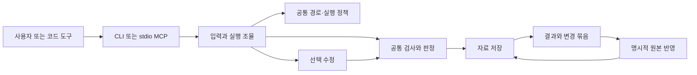

# 검증 가능한 화면 변경: 목표 설계

문서 버전: 1.0. 작성·조사일: 2026-10-14. 문서 확정은 [3심 기록](reviews/2026-10-14-three-review.md)의 최종 판단과 검토 대상 SHA256를 기준으로 한다.

2026-10-14 구현 보완: 기존 명령과 충돌하지 않도록 새 사용자 명령은 `ddk change verify/status/export/apply/recover`로 묶는다. 고정 실행계획은 새 DB·실행 상태 테이블이 아닌 criteria 입력 `criteria/execution.json`으로 보관한다. 해시·실행 권한·반영 권한은 기존 계약을 유지한다. 세부 입력과 현재 지원 범위는 [사용 안내](../VERIFIED-CHANGES.md)에 기록한다. 이 추가 문단은 이전 3심이 고정한 SHA 이후 변경이며 새 구현 검토의 대상이다.

**이 문서는 앞으로 구현할 계약이다. 현재 제품이 아래 기능·보장·성능을 제공한다는 설명이 아니다.** 설계 문서의 검토 완료는 제품 출시, 표준 인증, 업계 우위 또는 스타 수의 보증이 아니다.

2026-10-14 후속 구현: 기본 로컬 Docker 검사 작업을 연결한다. 기존 Environment 필드를 실제 실행과 대조하고, 앱 명령·화면 관찰을 분리하며, 검사 코드와 기준을 읽기 전용으로 제공한다. DB·필수 필드 변경은 없다. [후속 계획](../../.planning/phases/08-verified-change/11-ISOLATED-EXECUTION-PLAN.md)과 [후속 검토](../../.planning/phases/08-verified-change/12-ISOLATED-EXECUTION-REVIEW.md)는 이전 독립 심사 이후 변경의 범위와 제한을 명시한다.

## 1. 권위와 범위

이번 사용자 요청과 [설계 전 분석](reviews/2026-10-14-analysis.md)의 VCR-01~20을 설계 입력으로 사용한다. 현재 동작의 사실은 코드·실행 결과·기존 사용 안내가 우선한다. 미래 변경의 범위와 책임은 이 문서, 필드·저장 계약은 [저장 설계](35-verified-change-storage.md)와 [JSON Schema](verified-change/contract.schema.json), 수용 기준은 [검증 설계](36-verified-change-verification.md)가 담당한다. 필드·열거값이 다르면 JSON Schema에 맞춰 문서를 수정하며, 의미·관계 제약은 저장 설계의 별도 규칙을 따른다.

기존 `02~33`의 광범위한 장기 방향은 보관한다. 이번 목표 설계에 없는 기능을 해당 문서에서 자동으로 가져오지 않는다. 구현 중 기존 사용자 계약의 변경이 필요하면 실제 코드·시험·사용 안내를 함께 갱신하는 별도 변경으로 처리한다. [용어](verified-change/GLOSSARY.md)는 의미만 정의한다.

첫 대상: React·TypeScript 기반 Vite 또는 Next.js의 단일 웹 앱, 지정한 화면·사용 동작의 작은 변경. 기존 JavaScript·Astro 등의 사용 경로는 삭제하지 않으나 새 보장 수준의 첫 평가 대상에 포함하지 않는다. 대상 앱의 DB 변경·외부 실제 계정·자동 배포·다중 사용자 서버는 제외한다.

## 2. 목표와 사용 판단

사용자에게 제공할 결과는 요청한 변경, 기존 기능 보존의 검사, 변경 전후 자료, 확인하지 못한 항목, 비용과 필요한 후속 조치다. 정확한 판정과 재작업 감소를 핵심 가치로 검증한다.

1심은 이미지 생성 확대·전 범위 개발 도구·기존 변경의 독립 검사와 선택 수정 중 마지막 방향을 조건부 사용했다. 현재 검사·자료 저장·판정 책임을 재사용할 수 있고 기존 앱의 실패에 직접 대응하기 때문이다. 독점 기능으로 확인한 것은 아니며 기존 코드 도구와 Playwright 조합이 가장 강한 대안이다. 근거·반례·조건은 [1심 연구](reviews/2026-10-14-official-sources.md)에 기록한다.

우선순위:

1. 원본·비밀·실행 경계·불완전 응답·중단 복구의 결함을 먼저 해결한다.
2. 기존 변경을 모델 없이 검사하고 요구사항별 자료를 제공한다.
3. 동일 검사 계약 아래 제한된 자동 수정을 연결한다.
4. 같은 계약을 CLI와 MCP에서 재사용한다.
5. 실제 비교와 반복 사용 자료로 지원 확대 여부를 결정한다.

## 3. 사용자 절차와 관련 기능

### 3.1 처음 준비할 때

`doctor`가 프로젝트 종류·기존 검사·브라우저·실행 경계·의존성·지원하지 않는 조건을 확인한다. 먼저 조회만 수행하고 설치·신뢰 승인·모델 호출을 실행하지 않는다. 발견한 시험 명령은 후보이며 승인된 실행 계획에 포함되기 전에는 실행하지 않는다.

사용자는 요구사항과 보존할 동작을 지정한다. 이미 있는 시험·화면 기준을 우선 사용한다. 누락된 동작 검사는 초안으로 제안할 수 있으나 사용자가 확인하기 전에는 필수 검증으로 계산하지 않는다. 계획에는 검사 범위·명령·환경·변경 허용 경로·최대 시간·모델 비용·보장 수준을 함께 제시한다. 이후 동일한 고정 계획을 재사용하므로 매 실행마다 같은 질문을 반복하지 않는다.

### 3.2 기존 코드 도구의 변경을 검사할 때

기준 복사본과 변경 후보를 별도로 입력한다. 변경 이전에 딸깍이 보관한 기준이 없으면 사용자가 Git 기준과 변경 범위를 명시한다. `HEAD`나 가장 최근 실행을 임의로 기준으로 선택하지 않는다. 지정하지 않은 기존 수정과 새 변경이 섞여 있으면 `ambiguous_baseline`으로 중단하고 필요한 경로를 제시한다.

검사 전용은 모델 인증·이미지·설계 문서 생성을 요구하지 않는다. 시각 요구가 있는 항목만 기준 이미지나 승인된 이전 화면을 요구한다. 모델 호출 횟수와 비용은 0이다. 원본 작업 폴더는 검사 대상의 읽기 입력이며, 검사 작업은 별도 복사본에서 실행한다.

### 3.3 화면 변경과 수정이 필요할 때

기존 이미지 생성 경로의 결과나 외부 도구의 변경을 동일한 후보로 취급한다. 수정은 사용자가 선택한 경우에만 실행한다. 변경 허용 파일과 요청의 관계를 제시하며, 프로그램 파일의 `create/update`만 첫 범위에서 허용한다. 삭제·이동·의존성 추가·DB 변경·시험 및 승인 기준 변경은 자동 수정 대상에서 제외한다.

후보를 검사한 뒤 실패 자료로 수정한다. 최대 수정 횟수는 2회가 목표 기본값이며 현재 3회 설정과 구분한다. 사용자가 더 높은 한도를 승인할 수 있으나 전체 시간·호출·비용 상한은 늘어나지 않는다. 같은 실패와 같은 변경 해시가 반복되면 즉시 중단한다. 제한에 도달한 결과에는 현재 변경 묶음과 실패 자료를 함께 제공한다.

### 3.4 결과 확인과 원본 반영

요약에는 판정, 검사한 범위, 요구사항별 결과, 기존 기능 실패, 자료 위치, 실행 경계, 모델 비용, 필요한 다음 조치를 표시한다. `ready`는 지정한 범위의 검사 완료이며 원본 반영이나 전체 앱의 무결함을 뜻하지 않는다. 화면 점수·자체 종합 점수는 보조 자료이며 필수 실패를 상쇄하지 못한다.

변경 묶음 내보내기는 언제든 가능하지만 `verified` 표시에는 해당 자료의 무결성과 최신 실행을 확인해야 한다. `apply`는 원본 변경을 별도로 선택하는 동작이며 case·run·변경 해시를 명시해야 한다. 최근 실행 자동 선택과 `force/allow-blocked`를 새 계약에서 제공하지 않는다. 호환 처리와 복구는 §10·§12를 따른다.

## 4. 최소 구조와 책임

새 서버·작업 대기열·ORM·독립 서비스·새 조율 도구는 추가하지 않는다. Python·Typer·Pydantic·현재 LangGraph와 검사 연결을 유지한다. 검사 전용은 생성 그래프를 실행하지 않고 공통 검사 책임을 호출한다.

| 책임 | 작은 공개 계약 | 현재 재사용 대상 | 금지되는 중복 |
|---|---|---|---|
| 입력·조율 | `verify(case, candidate) -> run`; `repair(case, run) -> run` | `PipelineRunner`, `RuntimeServices`, CLI | 별도 CLI/MCP 판정 엔진 |
| 경로·권한 | `read_regular(path)`; `validate_change(change)` | `repo_paths`, `secret_paths`, `file_blocks` | 복사·문맥·수정·반영별 다른 보호 목록 |
| 검사 | `validate(case, baseline, candidate) -> results` | `RuntimeValidator`, `toolchain`, browser 연결 | 생성 전용과 독립 검사의 다른 성공 규칙 |
| 판정 | `decide(case, results, integrity) -> decision` | `ReleaseGate` | 종합 점수로 필수 실패를 덮는 판정 |
| 자료 저장 | `publish_run(run, artifacts)`; `load_verified(run_id)` | `CaseArtifactStore`, workspace | DB와 파일의 이중 정본 |
| 반영·복구 | `plan_apply(run)`; `apply(plan)`; `recover(apply_id)` | `ArtifactApplier` | 원본의 Git 전체 초기화·강제 덮어쓰기 |

의존 방향은 입구 → 조율 → 계약·정책 → 연결 도구다. 모델·브라우저·파일·Git 연결은 계약을 구현한다. 계약은 CLI·MCP·제공자 SDK를 가져오지 않는다. 모델 연결은 검사 전용에서 생성하지 않는다. 새로운 제공자는 공개 계약을 실제로 구현한 경우만 등록하며 이름만 예약한 설정을 지원으로 표시하지 않는다.

## 5. 기준 복사본과 수용 기준

`case`는 하나의 요청과 승인된 검사 계약이다. 고정한 원본·기준·환경·검사 파일을 SHA256 전체 값으로 참조한다. case를 수정하지 않고 새로운 case를 생성해 `supersedes_case_id`로 관계를 기록한다. 기존 결과를 새 기준으로 재분류하지 않는다.

기준·후보 복사에서는 일반 파일을 안전하게 열어 읽기 전후의 유형·존재·크기·mode·내용을 확인한다. 복사 후 전체 원본 목록과 해시를 다시 확인하며 차이·추가·삭제가 있으면 `snapshot_changed`로 중단한다. 사용자는 캡처 동안 외부 편집을 중지해야 한다. 파일 전체의 동시 상태를 운영체제 기능 없이 원자적으로 포착한다고 주장하지 않는다. 검사·수정은 고정한 복사본을 대상으로만 한다.

검사 항목의 역할은 `preserve`·`target`·`policy`다. `preserve`는 기준에서도 통과해야 한다. `target`은 변경하려는 요구이므로 기준에서 실패할 수 있지만 후보에서 통과해야 한다. `policy`는 보호·상한·자료 무결성을 확인한다. 모든 필수 항목은 실행 전에 확정하며 중간에 필수 여부·선택자·기대 결과·기준 이미지·허용 오차를 변경하지 않는다.

기존 시험은 파일·설정·실행 명령을 고정한다. 새 동작 검사는 사용자 확인 후 고정한다. 자동 수정에는 검사 계약과 보호된 시험·기준의 쓰기 권한을 제공하지 않는다. 기준 변경이 필요하면 이유를 제시하고 기존 case를 종료한다. 새 승인 기준은 새 case에서만 사용할 수 있다.

계약·원본·후보·환경·검사 해시가 결과에 연결되지 않으면 `ready`로 판정하지 않는다. 해시는 변조 탐지와 재현 식별이며 같은 계정의 악의적 조작에 대한 전자서명이나 신원 보증이 아니다.

## 6. 검사 계약

### 6.1 기존 시험과 프로그램 검사

발견된 빌드·타입·코드 규칙·Vitest/Jest·Playwright 명령을 재사용한다. 실행 파일과 인자를 배열로 고정하며 셸 문자열을 평가하지 않는다. 명령 존재와 종료 코드 0만으로 실제 시험 실행을 주장하지 않는다. 프로그램 작업의 stdout·JSON·보고서는 관찰 자료이며 최종 판정은 딸깍 소유 검사 작업이 승인된 기준과 실제 관찰 자료로 계산한다. 후보를 import하는 Node 시험은 후보와 같은 권한을 얻을 수 있어 적극적 결과 위조 방지를 보장하지 않는다. 기존 시험은 해당 도구가 보고한 결과로 표시하며, 화면 변경의 필수 목표와 핵심 보존 동작에는 별도 검사 작업의 관찰을 반드시 포함한다. 지원하는 결과 형식에서는 실행 수·실패·건너뜀을 수집하고, 시험 수 0·해석 불가·누락은 `unavailable`로 처리한다. 지원하지 않는 사용자 정의 명령은 승인된 명령 검사로만 표시하고 시험 범위로 확대하지 않는다.

필수 시험은 기준과 후보에서 같은 조건으로 실행한다. 기준의 보존 시험이 실패하면 `baseline_failed`로 중단한다. 예외를 조용히 등록하지 않는다. 실패가 원래 결함이라면 수정 목표와 보존 범위를 다시 지정한 새 case가 필요하다.

### 6.2 실제 사용 동작

한 사용 시나리오의 이동·입력·클릭·검사·오류 수집·화면 자료는 같은 브라우저 context에서 실행한다. 시나리오 사이에는 context를 분리한다. 역할·접근 가능한 이름·label 선택자를 우선하며, 고정된 CSS 선택자는 승인 계약에 명시한다. 선택자 자동 교체는 통과 경로에 포함하지 않는다.

고정 대기 시간 대신 기대 상태에 대한 제한된 재시도 검사를 사용한다. console·pageerror·실패 요청은 해당 시나리오와 함께 수집한다. 재시도 성공 전 실패를 삭제하지 않으며 `flaky`인 필수 검사는 `ready`를 막는다. 허용한 경고·요청은 사전에 고정한 항목만 제외하며 실행 중 새 예외를 만들지 않는다. [Playwright assertions](https://playwright.dev/docs/test-assertions), [isolation](https://playwright.dev/docs/browser-contexts).

### 6.3 화면·접근성·데이터

요구에 지정된 각 화면 상태와 크기를 검사한다. 첫 기본 크기 후보는 1280×800·390×844이며 실제 제품 요구로 승인한 값이 우선한다. 고정 데이터·locale·timezone·브라우저 버전·글꼴·동작 효과·시간 조건을 기준과 후보에 동일하게 사용한다. 승인되지 않은 마스킹·허용 오차 증가는 금지한다.

SSIM은 기존 비교의 보조 지표로 유지한다. 색·텍스트·레이아웃·표시 상태는 각각 해당 요구의 명시적 검사로 확인한다. 화면 이미지 점수 하나로 사용 동작을 통과시키지 않는다. 화면 전체에 대한 설계 의도를 자동으로 완전히 판단한다고 주장하지 않는다.

키보드 이동·focus·입력 label·오류 안내 등의 요구를 관련 동작에 포함한다. 자동 접근성 검사로 전체 WCAG 준수를 선언하지 않는다. 실제 로그인·외부 서버·결제의 시험은 첫 범위에서 제외하고 fixture를 사용한 경우 `mocked` 범위를 결과에 표시한다. 외부 서버 정상 동작의 근거로 확대하지 않는다. [WCAG 2.2](https://www.w3.org/TR/WCAG22/).

## 7. 실행 경계와 개인정보

신뢰하는 구성은 사용자 승인 기준, 딸깍 호스트 제어·판정 코드, 승인된 실행기와 OS다. 저장소·후보 프로그램·모델 응답·웹 내용·프로그램 보고서는 신뢰하지 않는 입력이다. OS·실행기 취약점, 같은 사용자 권한의 악의적 호스트 프로그램, 승인 기준 자체의 잘못된 의미까지 이 도구가 제거한다고 주장하지 않는다. 자료 해시와 읽기 전용 기준은 이 경계 안의 변조 탐지이며 사용자 승인·신원 서명을 대신하지 않는다.

### 7.1 격리 실행

새 자동 검사·수정 경로의 기본은 `isolated`다. 한 앱 작업과 별도 검사 작업이 동일한 차단된 네트워크를 공유하되 PID·파일 공간은 분리한다. 앱은 외부 네트워크가 없는 실행 환경에서 실행하고 검사 작업은 그 앱의 네트워크만 공유한다. 호스트 브라우저를 해당 네트워크에 연결하는 방식으로 대체하지 않는다.

실행 전 확인할 정책: 일반 사용자 실행, 권한 추가 없음, `no-new-privileges`, 앱의 기본 seccomp와 검사 작업의 검토된 Chromium용 seccomp 적용, 파일 공간의 필요한 쓰기 범위만 제공, CPU·메모리·프로세스 수 상한, 호스트 원본·인증·Docker socket·호스트 network/PID 미제공. 검사 작업에만 읽기 전용 승인 기준과 소유한 결과 폴더를 제공한다. 결과 파일은 일반 파일·상한·경로를 재검증하여 호스트가 수집한다. 검사 작업의 제어는 공통 네트워크에 서버를 열지 않고 표준 입출력의 제한된 자료 전달로 처리한다. 브라우저 debugging port도 열지 않는다. 기준을 프로그램 작업의 쓰기 가능한 위치에 복사하지 않는다.

첫 범위는 로컬 Docker 호환 실행기다. 선택한 context와 endpoint, DOCKER_HOST·DOCKER_CONTEXT의 실제 우선순위를 로컬 설정에서 확인하며 원격 SSH·TCP endpoint에는 연결·파일 전달 없이 isolation_unavailable을 반환한다. 실행기의 실제 정책 적용과 namespace·mount·자원 제한을 사전 검사한다. Linux의 사용자 권한 제한 실행과 macOS/Windows의 VM 경계를 구분해 기록한다. 지원하지 않는 기능·실행기 없음·정책 확인 실패는 `isolation_unavailable`이며 호스트 실행으로 자동 대체하지 않는다. 컨테이너 실행기를 설치하거나 시스템 권한을 바꾸는 작업은 자동 실행하지 않는다. [Docker security](https://docs.docker.com/engine/security/).

검사 브라우저는 `headless=True`, `chromium_sandbox=True`를 명시하고 별도 일반 사용자로 실행한다. 검토한 seccomp와 제한된 공유 메모리 크기를 환경 정보에 포함하며 실제 시작·차단 시험을 한다. 실패 시 root 사용자·`--no-sandbox`·`--privileged`·`--ipc=host`·권한 추가로 자동 대체하지 않는다. 실행기·브라우저·검사 코드·이미지는 동일하게 고정하며 공개 Playwright 이미지를 그 자체로 안전하다고 판단하지 않는다. [Playwright Docker](https://playwright.dev/python/docs/docker), [브라우저 보호 설정](https://playwright.dev/python/docs/api/class-browsertype#browser-type-launch-option-chromium-sandbox).

의존성 준비는 실행과 분리한다. 잠금 파일을 고정하고 승인된 저장소에서만 내려받으며 설치 script는 기본 차단한다. 필요한 설치 작업은 승인된 격리 환경에서만 실행한다. 검사 단계는 외부 연결 없이 실행한다. 외부 글꼴·이미지·서버가 필요하면 고정된 로컬 자료를 지정하거나 `environment_gap`으로 표시한다. 외부 접근을 조용히 허용하여 화면 점수를 높이지 않는다.

### 7.2 승인된 개인 환경 실행

`trusted-local`은 사용자가 승인한 프로젝트의 선택 모드다. 원본 사본과 경로 보호를 제공하지만 OS 격리를 제공하지 않는다. 프로젝트 script와 생성 코드가 사용자 권한으로 실행됨을 준비 단계와 결과에 표시한다. `ready`와 별도로 보장 수준을 항상 표시하며 격리 실행 결과로 계산하지 않는다. CI의 격리 필수 정책은 이 모드의 결과를 거부한다. 기존 이미지 CLI는 이 표시를 추가하는 단계적 호환 경로로 유지한다.

Case.assurance_required는 결과에 필요한 최소 보장 수준이며 실행 권한이 아니다. 첫 MCP 검사·수정은 isolated만 실행한다. trusted-local은 CLI에서 사용자가 원본·후보·명령·상한·보장 제한을 확인하고 명시적으로 선택한 경우만 허용하며, 계획의 내용이 달라지면 다시 선택해야 한다. 저장소·case·모델 응답의 값이나 기존 Operator의 출시·주장 승인을 호스트 실행 승인으로 재사용하지 않는다. 별도 인증 서버는 추가하지 않는다.

### 7.3 공통 보호

복사·문맥·생성·수정·자료 수집·반영에 같은 경로 정책을 사용한다. `.git`, `.ddk`, 도구 인증·설정, `.env*`, 개인 키·인증 파일, 저장소 외부 경로는 자동 접근·변경 대상에서 제외한다. 필요 데이터는 명시적 파일 선택으로 별도 승인하되 인증 저장 경로는 끝까지 제외한다.

경로는 상대 POSIX 표현으로 검증하고 절대 경로·`..`·NUL·역슬래시·이름 충돌을 거부한다. symlink·일반 파일이 아닌 경로·외부 hardlink 의심 경로는 거부한다. 각 부모 경로의 실제 유형과 경계를 쓰기 직전 재검증한다. 같은 계정의 악의적 경로 교체까지 보호한다고 주장하지 않으며 그런 조건에서는 원본 반영을 제공하지 않는다.

Git 기준 구성을 위해 승인된 연결이 Git 정보를 조회할 수 있으나 .git 내용은 복사·모델 입력·프로그램 작업에 제공하지 않는다.

모델에는 승인 범위의 일반 파일·요구·실패 자료만 제공한다. 저장소 내용과 웹 자료는 지시가 아닌 입력으로 취급한다. 모델 응답으로 권한·기준·실행 정책을 변경할 수 없다. 원본 프롬프트·응답·화면·실행 기록은 민감할 수 있으므로 공개 내보내기는 기본 제외한다. trace에는 비밀이 포함될 수 있어 단순 문자열 삭제만으로 안전한 공개를 보증하지 않는다. HTML 보고서는 값 전체를 escape하고 외부 script·이미지·경로 이동을 허용하지 않는다. [OWASP prompt injection](https://genai.owasp.org/llmrisk/llm01-prompt-injection/).

## 8. 판정·상태·상한

run 상태와 결과 판정은 구분한다. 상태는 `prepared → running → completed` 또는 `cancelled/failed`다. 종료한 run은 다시 실행하지 않고 사용자가 명시한 새 요청에만 새 run을 생성한다. 한 repair 요청의 자동 수정과 재검사는 같은 run의 회차로 기록하며 상한을 초기화하지 않는다. case는 고정 정의이며 실행 상태를 저장하지 않는다.

| 판정 | 필요 조건 |
|---|---|
| `ready` | 필수 결과 전부 존재·통과, 보존 기준 통과, 모든 요구 대응, 계약·환경·후보·자료 해시 일치, 종료·정리 완료, 미확인 필수 항목 없음 |
| `blocked` | 실행·기준·권한·자료·범위 오류로 판단 불가 또는 필수 실패·불안정 확인 |
| `manual-review` | 필수 항목에 실패·누락이 없지만 선택 항목의 문제 또는 별도 수용 검토가 필요함; 필수 실패를 통과로 변경하지 않음 |

판정 우선순위는 종료 미완료의 `null` → 필수 실패·누락·무결성 오류의 `blocked` → 필수 통과 상태에서 추가 검토가 필요한 `manual-review` → `ready`다. 수정 한도에 도달한 뒤 필수 실패가 있으면 `blocked`와 사람의 조치를 함께 표시한다. `manual-review`를 사용해 실패·자료 부족을 낮은 위험으로 표시하지 않는다.

취소·중단·자료 미공개 상태에서는 결과 판정을 `null`로 유지한다. 종료 코드: 0은 `ready`, 1은 검사 결과가 `blocked/manual-review`, 2는 입력·설정·환경 오류, 130은 취소. JSON 입력은 파싱 전 2MiB·깊이 32 상한을 적용하고 외부 schema 참조를 조회하지 않는다. JSON 출력은 schema version·case/run ID·판정·범위·보장 수준·자료 위치·비용·조치 목록을 포함하며 진행은 stderr로 출력한다.

목표 기본 상한: 단계별 300초, 실행 전체 1,800초, 취소 후 10초 안에 정리·필요 시 강제 종료, 수정 2회, 제공자 요청 총 12회, 모델 비용 2,000,000 micro-USD, 일반 파일 2MiB, 실행 출력 총 10MiB, 자료 총 200MiB, 변경 파일 20개, 작업 하나당 CPU 1개·메모리 2GiB·프로세스 256개, 검사 작업 공유 메모리 256MiB. 수치는 초기 제품 정책이며 업계 표준이나 실측 성능이 아니다. 승인된 설정으로 변경 가능하되 기록 없이 완화하지 않는다. 상한 초과는 중단 또는 상한 내 요약으로 처리하고 누락을 표시한다.

단계·실행·정리의 시간 상한은 `time.monotonic_ns()`의 차이로 집행한다. Run.duration_ms는 준비부터 정리 종료까지 같은 방식으로 측정한 시간이며 완료 기록에서는 필수다. UTC 시각은 표시·검색용이며 시각 보정으로 기한을 연장하거나 UTC 차이만으로 실행 시간을 계산하지 않는다. 중단한 실행은 새 시계 기준으로 자동 재개하지 않는다. [Python 시간 함수](https://docs.python.org/3.12/library/time.html#time.monotonic_ns).

비용은 정수 micro-USD로 관리한다. 각 요청의 예상 최대 비용을 호출 전에 예약하고, 실제 usage로 정산한다. usage가 없거나 가격·모델 한도를 확인할 수 없으면 추가 호출을 차단한다. 취소·재시도·응답 길이 제한도 요청 횟수와 비용에서 제외하지 않는다. SDK의 자동 재시도는 0으로 설정하고 제공자 HTTP 시도마다 단일 비용 책임에서 예약·횟수·시간을 기록한다. 취소 후 usage가 불명인 예약은 해제하지 않으며 다음 요청을 막는다. 불완전·잘린 응답은 일부 파일이라도 반영하지 않는다. 제공자 재시도는 실행 전체 시간·요청·비용 한도 안에서만 허용한다.

같은 사례의 모델 요청은 저장 계약의 소유 잠금으로 직렬화한다. 서로 다른 run_id도 미정 예약 확인부터 예약의 내구성·HTTP 시도·정산 기록까지 동시에 진행할 수 없다. 조회·검사 전용은 이 비용 잠금을 사용하지 않는다. 실제 비용이 예약을 넘으면 관측값과 조치를 보존하고 blocked로 종료하며, 기록을 정상 한도에 맞춰 줄이지 않는다.

시간 초과·취소는 process group 또는 소유한 격리 작업 전체를 종료하고, 브라우저·미리보기·자식 작업·잠금을 정리한다. 정리 실패는 기록하며 `ready`를 금지한다. PID만으로 다른 작업을 종료하지 않고 소유 ID·생성 정보를 함께 확인한다.

## 9. 저장과 실행 도중 중단

현재 파일 저장을 유지한다. case와 완료한 run은 변경하지 않는다. 산출 파일을 먼저 보존·검증하고 run manifest를 마지막에 원자적으로 공개한다. manifest가 없거나 참조 파일의 해시가 다르면 완료 결과로 조회하지 않는다. HTML·요약은 manifest에서 재생성 가능한 표시 자료이며 성공의 정본이 아니다.

하나의 저장소에서는 원본 반영을 한 작성자로 제한한다. 사례 ID·실행 ID는 UUID로 충돌을 방지한다. `C-NNN`은 기존 사례의 별칭으로만 취급하며 이름에 경로 요소를 허용하지 않는다. schema-v1 자료는 그대로 조회하고 새 보장 결과로 승격하지 않는다. 자세한 필드·잠금·저장·복구·보존 계약은 [저장 설계](35-verified-change-storage.md)에만 정의한다.

## 10. 원본 반영과 복구

첫 반영 경로의 기본은 변경 묶음 내보내기다. 관리된 반영은 다음 조건을 모두 만족할 때만 제공한다: 완료 판정이 ready인 run과 해당 case·변경 해시 선택, 자료 무결성, 지정한 보장 정책 충족, 전체 경로 사전 검사, 대상 현재 해시·mode·존재 여부의 기준 일치, 동시 편집 중지 확인, 저장소 작성 잠금, 복구 자료의 내구성 확인.

반영 기록을 먼저 보존하고 파일마다 임시 파일 작성·flush/fsync·같은 파일 공간에서 교체한다. 새 파일은 기존 경로를 덮지 않는 배타 생성 방식으로 반영한다. 반영 전 존재했던 파일이 사라졌다면 새 파일로 분류하지 않고 충돌이다. 대상의 mode와 개행을 보존하며 파일 삭제·권한 확대를 수행하지 않는다.

모든 새 파일 해시와 관련 원본 상태를 다시 확인한 뒤 `applied`를 보존한다. 다파일 교체는 외부 관찰상 원자적이지 않으며 해시 확인 직후의 비협조적 외부 편집을 막지 못한다. 보장 시점과 제한을 보고서에 표시한다. 파일 교체·내구성 보장이 확인되지 않은 파일 공간에서는 관리된 반영을 막고 내보내기만 제공한다.

실패·중단 후 현재 존재 여부·일반 파일 유형·mode·해시가 예정한 새 상태와 전부 같으면 이전 상태로 복구하고, 이전 상태와 같으면 유지한다. 생성 파일의 복구 삭제는 딸깍이 만든 파일이며 새 상태 전체가 같을 때만 한다. 내용이 같아도 외부 mode 변경이 있으면 자동 쓰기를 중지한다. 둘 다 아니면 외부 변경으로 판단해 자동 쓰기를 중지한다. 복구 단계의 모든 쓰기에서도 기대 상태를 다시 확인한다. 복구한 전체 존재 여부·일반 유형·mode·해시가 맞으면 `rolled_back`, 아니면 `unknown`이다. `unknown`은 반영·재반영·자료 삭제를 막고 남은 경로와 필요한 확인을 제시한다. `git reset --hard`, `git clean`, 원본 stash 조작으로 복구하지 않는다.

같은 apply ID 재요청은 기존 결과 조회다. 새 반영 요청은 새 apply ID와 현재 해시 확인이 필요하다. MCP의 재요청·연결 종료는 이 계약을 변경하지 않는다. 반영 진행 중 취소는 안전한 중간 지점에서 중단·복구하며, 이미 공개한 완료 결과를 취소로 지우지 않는다.

## 11. CLI·MCP와 편의성

새 명령의 계약은 `verify`·`repair`·`export`·`apply`·`recover`·`status`다. 실제 명령 추가는 구현 단계의 과제이며 현재 제공된다고 안내하지 않는다. `verify` 입력은 case 정의와 명시적 후보, `repair`는 case/run과 상한, `apply`는 case/run/변경 해시·보장 정책·동시 편집 조건이다. `status`는 조회만 수행하며 중단된 작업을 자동 재실행하지 않는다.

stdio MCP는 같은 서비스와 JSON 결과를 호출한다. 공개 검사 도구는 `ddk_verify`, `ddk_status`, 선택 수정은 `ddk_repair`다. 첫 MCP 연결에서 원본 반영·설치·강제 복구·trusted-local 실행은 공개하지 않고 CLI의 명시적 사용자 동작으로 유지한다. 요청 재전송에는 안정된 run_id와 request_sha256을 사용해 중복 실행을 방지한다. 같은 ID의 다른 case·작업·후보·상한은 request_conflict로 거부한다. 도구 입력은 명확한 schema와 크기 제한을 제공한다.

잠금 SDK는 `mcp==1.28.1`이며 실제 지원 판을 협상한다. 최신 공식 판 지원은 별도 상호운용 시험 전까지 주장하지 않는다. 지원하지 않는 협상은 오류로 종료하며 버전 문자열만 높이지 않는다. 검사 실패는 정상 도구 결과의 결과 판정으로 제공하고, 입력·실행 불가는 해당 지원 판의 도구 오류로 제공한다. 취소는 소유 run에 대응시키며 연결 종료를 결과 삭제로 해석하지 않는다. [현재 MCP 규약](https://modelcontextprotocol.io/specification/latest), `uv.lock:925–927`.

결과 조치는 코드·대상·설명·재시도 가능 여부를 포함한다. 예: `ambiguous_baseline`은 기준과 혼합 변경 경로, `isolation_unavailable`은 확인 실패한 기능, `baseline_failed`는 변경 전 실패 자료, `criteria_changed`는 기준 해시 차이, `apply_conflict`는 예상·현재 해시, `recovery_unknown`은 자동 조치 중단 경로를 제공한다. 성공 메시지에는 검사 범위를 먼저 표시한다.

## 12. 기존 기능의 전환

| 단계 | 구현 범위 | 기존 사용자 보호 | 다음 단계 조건 |
|---|---|---|---|
| D0 | 경로 정책·원본 반영·취소·불완전 응답 보강 | 기존 사용 안내와 결과 형식 유지; 위험 동작은 명확한 오류 | 보호·복구·기존 시험 통과 |
| D1 | 새 고정 case·독립 검사·파일 새 계약 자료 | v1 읽기 유지; 새 계약 자료를 별도 위치에 저장 | 모델 없이 검사·기준 보존·무결성 시험 통과 |
| D2 | 요구별 동작·화면·격리 검사 | 지원하지 않는 환경은 표시; 호스트 대체 없음 | 실제 브라우저·격리·취소·자료 시험 통과 |
| D3 | 선택 수정·제한 반영·stdio MCP | 기존 이미지 결과도 동일 검사로 연결; 새 검증 범위 명시 | 기준 변경 방지·비용·중복 요청·전송 시험 통과 |
| D4 | 실제 과제 비교·외부 반복 사용 | 성능·지원 주장에 조건과 표본 공개 | 독립 평가 후 지원 확대 판단 |

기존 `apply --force/--allow-blocked`, 원본 Git 강제 복구는 안전 계약을 훼손하므로 호환을 이유로 유지하지 않는다. 구현 시 명확한 거부와 대체 내보내기 경로를 안내한다. 기존 자료를 삭제하거나 전체 문서를 새 설계로 변경하는 전환은 수행하지 않는다.

## 13. 실용성·품질 목표와 실측

ISO/IEC 25010:2023의 공개 설명은 품질 요구와 평가를 위한 참고로 사용한다. 공개 요약만으로 전체 조항 준수나 인증을 주장하지 않는다. 이번 설계의 목표는 정확성·원본 보존·실패 복구·편의성·책임의 집중·재사용·명확한 지원 경계에 대응한다. [ISO 공식 설명](https://www.iso.org/standard/78176.html).

초기 목표: 모델 없는 준비 결과 p95 2초 이내(의존성 설치·원본 복사 제외), 로컬 상태 조회 p95 500ms 이내(사례 1,000개·각 manifest 1MiB 이하), 원본 반영 중 실패의 미보고 0건, 필수 자료 누락의 잘못된 통과 0건, 정리 기한 위반의 성공 표시 0건. 시간 목표는 지정된 평가 장비·데이터에서 측정해야 하며 현재 성능이 아니다. 상한 내 파일 저장을 측정해 병목이 확인된 경우에만 SQLite·검색 기능을 다시 검토한다.

경쟁 비교는 설치·기준 준비·검토·수정·재시도 시간과 비용을 포함한다. 최초 목표 후보는 사람의 직접 작업 시간 중앙값 30% 감소, 잘못된 통과·기존 기능 훼손 증가 없음, 외부 사용자의 다음 실제 작업에서 반복 선택이다. 30%는 제품 판단 목표이며 통계적 보장이나 업계 기준이 아니다. 자료 분리·실패 포함·반복의 종속성·측정 방법은 [검증 설계](36-verified-change-verification.md)에 정의한다.

## 14. 실제 대안이 있는 결정

| 결정 | 선택·이유 | 제외 대안 | 다시 판단할 조건 |
|---|---|---|---|
| ADR-VC-01 제품 범위 | 기존 변경의 독립 검사·선택 수정; 현재 자산과 재작업 목표에 대응 | 이미지 생성 확대·전 범위 개발 도구 우선 | 실제 비교에서 가치가 확인되지 않음 |
| ADR-VC-02 저장 | 사례별 고정 파일·단일 manifest 공개; 현재 파일 자료 재사용 | SQLite·외부 DB | 관계 조회·작성자 대기·복구 비용의 실측이 파일 구조보다 불리 |
| ADR-VC-03 실행 | 격리 결과와 승인된 개인 환경 결과를 구분 | 임시 폴더를 격리로 주장·실패 시 자동 호스트 실행 | 지원 장비별 경계 검사·도입 실패 결과 |
| ADR-VC-04 반영 | 내보내기 기본·조건 충족 시 기록 기반 반영 | 자동 원본 수정·강제 Git 초기화 | 동시 편집 제어·내구성을 입증할 다른 최소 방식 |

모든 구성은 VCR 요구나 구체 실패 위험에 연결한다. 승인 기준에 대한 모델의 자기평가, 여러 모델 합의, 별도 점수 체계, 추가 제공자·DB·서버를 기능 수의 증가만을 이유로 사용하지 않는다.

## 15. 검토와 확정

1심의 사용 조건을 반영했다. 2심은 실패 반례와 불필요한 구성, 3심은 수정된 문서·필드·수용 기준·검증 자료를 별도 담당자가 검토한다. 검토 대상 SHA256, 지적, 반영 여부, 재확인 범위를 [검토 기록](reviews/2026-10-14-three-review.md)에 보관한다. 중대 지적이 남으면 확정하지 않는다.

문서 검사 통과는 내부 참조·schema·관계·예시·판정 규칙의 정합성만 증명한다. 실제 모델·OS 격리·전원 중단·브라우저·동시 편집·생산성 효과·사용성은 구현 후 실행 조건이다. 해당 자료 없이 ‘100점’·‘표준 이상’·‘업계 최상위’로 평가하지 않는다.
